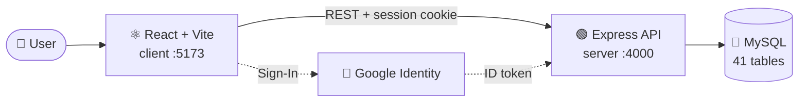
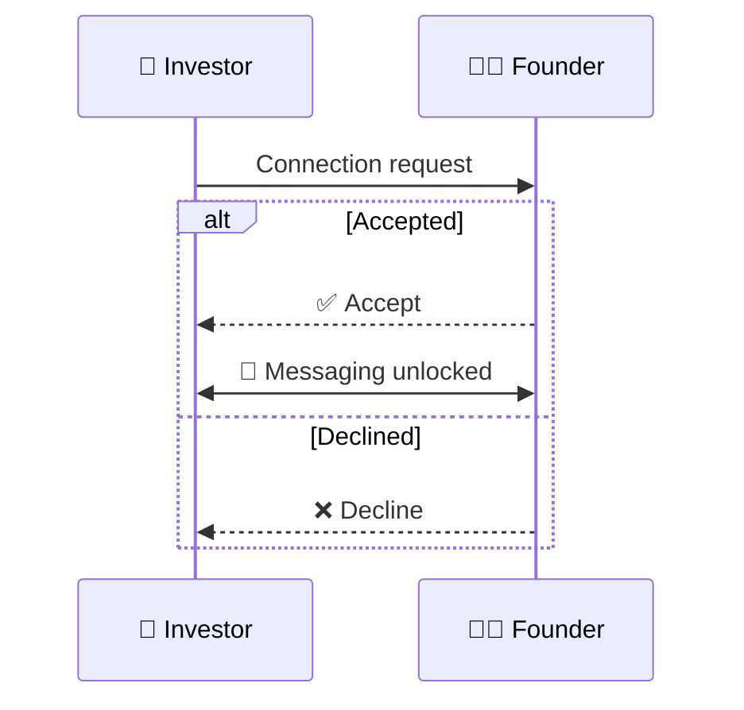

<div align="center">


# 🦈 Sauda

### *Where startups meet the Sharks.*

A full-stack platform that turns scattered **Shark Tank India** data into a searchable database,<br/>and lets founders pitch while investors discover, connect and talk.

<br/>


<sub>🎓 An independent academic prototype built for a college DBMS project. Not an official Shark Tank India service.</sub>

<br/>

[✨ Features](#-features) · [🎭 Roles](#-roles) · [🏗️ Architecture](#️-architecture) · [🚀 Quick Start](#-quick-start) · [🧪 Testing](#-testing) · [📚 Docs](#-documentation)

</div>

---

## 💡 Why Sauda?

Every season of *Shark Tank India* produces a flood of data: startups, founders, asks, offers, deals. It lives across episodes and sources, so even a simple question like *"which food startups got an offer from a particular Shark?"* means digging through many places.

**Sauda puts it all on one relational foundation** and adds a place where founders can showcase their startups and investors can reach them.

| 📊 For the curious | 🚀 For founders | 💼 For investors |
|---|---|---|
| Explore seasons, episodes, Sharks and deals. Filter, compare, see the stats. | Publish a startup listing, get reviewed, accept or decline interest. | Discover startups, build a watchlist, request a connection, chat. |

---

## ✨ Features

<table>
<tr>
<td width="50%" valign="top">

### 📺 Historical Explorer
- Browse **seasons → episodes → pitches**
- Offers and deal outcomes per pitch
- Filter by season, sector, Shark, deal status
- **Side-by-side startup comparison**
- Aggregate statistics from live SQL

### 🛡️ Admin Console
- Full CRUD on historical records
- **CSV import** with validation and history
- Pitch **review and moderation** workflow
- User and role management

</td>
<td width="50%" valign="top">

### 🧑‍💼 Founder Workspace
- Create and edit startup listings
- Submit for admin review, read feedback
- Archive pitches
- Accept or decline investor requests

### 🦈 Investor Workspace
- Dashboard and startup discovery
- Watchlist
- Send, withdraw and end connection requests
- **Messaging** unlocked after acceptance

</td>
</tr>
</table>

### 🎬 Cinematic touches
A full-screen **shark intro** (with an automatic canvas fallback if the video is missing), a **pitch arena** hero, a custom loader, and **Mako**, the in-app shark guide who offers hints along the way.

---

## 🎭 Roles

| | Role | What they can do |
|:-:|---|---|
| 👀 | **Viewer** *(default)* | Browse, search, compare, view statistics |
| 🧑‍💼 | **Founder** | Everything a viewer can, plus manage own listings and respond to requests |
| 💼 | **Investor** | Everything a viewer can, plus connect, watchlist and message accepted founders |
| 🛡️ | **Admin** | Manage historical data, imports, pitch reviews and user roles |

> 🦈 Historical Sharks are **data records**, not a role. A Shark can also sign up as an investor, but the two records stay separate.

---

## 🏗️ Architecture



**Connection flow**



<details>
<summary><b>📁 Project structure</b></summary>

```
Sauda-SharkTank/
├── client/                  ⚛️  React + Vite frontend
│   ├── public/media/        🎬 intro and pitch-arena videos
│   └── src/
│       ├── components/      admin · auth · compare · connections · dashboard
│       │                    founder · home · intro · investor · mako · profile ...
│       ├── services/        api · auth · workspace clients
│       ├── types/
│       └── utils/
├── server/                  🟢 Express + TypeScript API
│   ├── src/                 routes, auth, founder, historical, adminReview, tests
│   └── scripts/db/          migration runner + test DB tooling
├── database/                🐬 baseline schema, migrations, preflight SQL
├── docs/                    📚 requirements, ER model, design decisions
└── PHASE*_MANIFEST.md       📝 per-phase change manifests and apply guides
```

</details>

---

## 🚀 Quick Start

### Prerequisites

- **Node.js** 20+ and npm
- **MySQL** 8+
- A **Google OAuth 2.0 Web Client ID** ([create one here](https://console.cloud.google.com/apis/credentials))

### 1️⃣ Install

```bash
git clone <your-repo-url>
cd Sauda-SharkTank

cd server && npm install
cd ../client && npm install
```

### 2️⃣ Configure

<details open>
<summary><b>🟢 Backend</b> <code>server/.env</code></summary>

```bash
cd server && cp .env.example .env
```

```env
PORT=4000
DB_HOST=127.0.0.1
DB_PORT=3306
DB_USER=sauda_user
DB_PASSWORD=your_database_password
DB_NAME=sharktank_db
DB_CONNECTION_LIMIT=5

GOOGLE_CLIENT_ID=your-google-client-id.apps.googleusercontent.com
AUTH_SESSION_SECRET=<random string, 32+ characters>
```

</details>

<details open>
<summary><b>⚛️ Frontend</b> <code>client/.env</code></summary>

```bash
cd client && cp .env.example .env
```

```env
VITE_API_URL=http://localhost:4000
VITE_GOOGLE_CLIENT_ID=<same client ID as the backend>
```

</details>

> 🔑 In Google Cloud Console, add `http://localhost:5173` and `http://127.0.0.1:5173` as **Authorized JavaScript origins**.

### 3️⃣ Set up the database

Create the MySQL database and user, then load `database/baseline/001_baseline_schema.sql` followed by `002_reference_seed.sql`.

> ⚠️ Industry and startup-stage reference tables are **not seeded**. Add those rows yourself.
> Migrations **never** run on server start. See [`database/README.md`](database/README.md).

### 4️⃣ Launch 🎉

```bash
# Terminal 1 · API        → http://localhost:4000
cd server && npm run dev

# Terminal 2 · Frontend   → http://localhost:5173
cd client && npm run dev
```

Health checks: `GET /api/health` · `GET /api/health/db`

---

## 🧰 Scripts

<table>
<tr>
<td valign="top">

**🟢 Server**

| Command | Does |
|---|---|
| `npm run dev` | Hot-reload API |
| `npm run build` | Compile |
| `npm start` | Run build |
| `npm run typecheck` | Type-check |
| `npm test` | Full test suite |
| `npm run db:migrate -- --list` | Migration status |
| `npm run db:verify-admin` | Check admin setup |

</td>
<td valign="top">

**⚛️ Client**

| Command | Does |
|---|---|
| `npm run dev` | Vite dev server |
| `npm run build` | Type-check + build |
| `npm run lint` | Oxlint |
| `npm run preview` | Preview build |

</td>
</tr>
</table>

---

## 🔌 API at a glance

| Area | Endpoints |
|---|---|
| 🔐 **Auth** | `POST /api/auth/google` · `GET /api/auth/me` · `POST /api/auth/logout` |
| 👤 **Profiles** | `/api/user/profile` · `/api/founder/profile` · `/api/investor/profile` |
| 🧑‍💼 **Founder** | `/api/founder/pitches` (CRUD + archive) |
| 💼 **Investor** | `/api/investor/dashboard` · `/api/investor/pitches` · `/api/investor/watchlist/toggle` |
| 🤝 **Connections** | `/api/connections/request` · `/respond` · `/withdraw` · `/end` |
| 💬 **Messaging** | `/api/conversations/:id/messages` |
| 📺 **Historical** | `/api/historical/seasons` · `/episodes/:id` · `/pitches` · `/sharks` |
| 🔎 **Discovery** | `/api/startups` · `/api/startups/compare` · `/api/statistics/historical` |
| 🛡️ **Admin** | `/api/admin/historical/*` · `/api/admin/reviews/*` · `/api/admin/users/:id/roles` |

---

## 🧪 Testing

```bash
cd server
npm test        # typecheck, build, and all unit tests, no database needed
```

<details>
<summary><b>🗄️ Integration tests (disposable database only)</b></summary>

<br/>

Integration tests change data, so they are locked behind several safety guards.

1. Create an **empty** database matching `sauda_test_[a-z0-9_]+`
2. Add the `TEST_DB_*` variables from `server/test.env.example` to `server/.env`
3. Load the baseline:
   ```bash
   SAUDA_ALLOW_DESTRUCTIVE_TESTS=yes npm run db:test:create
   ```
4. Run a suite, for example `npm run test:integration:admin-review`

🛑 The tooling permanently refuses to touch `sharktank_db`, and refuses any database not named `sauda_test_*`.

⚠️ **Migration 004** (admin pitch-review history) is still **DRAFT**. Do not apply it to your main database until reviewed.

Full guide: [`server/scripts/db/TEST_DATABASE_SETUP.md`](server/scripts/db/TEST_DATABASE_SETUP.md)

</details>

---

## 📚 Documentation

| Phase | Covers |
|---|---|
| **B · Requirements** | Problem statement, user roles, functional and non-functional requirements, use cases, system architecture, scope |
| **C · Design** | Entity inventory, ER model and diagram, relational mapping, normalization review |
| **D · Migration** | Schema gap analysis and migration plan |
| **Workflows** | Admin pitch review and moderation |

All in [`docs/`](docs/).

---

## 🔒 Security notes

- Never commit `.env` files (they are git-ignored)
- Use a strong random `AUTH_SESSION_SECRET` (32+ characters)
- Google Sign-In only proves control of a Google account. It does **not** verify founder or investor credentials.

---

<div align="center">

**Built with ☕ and 🦈 for a DBMS course project**

<sub>Add a license of your choice before public release.</sub>

</div>
