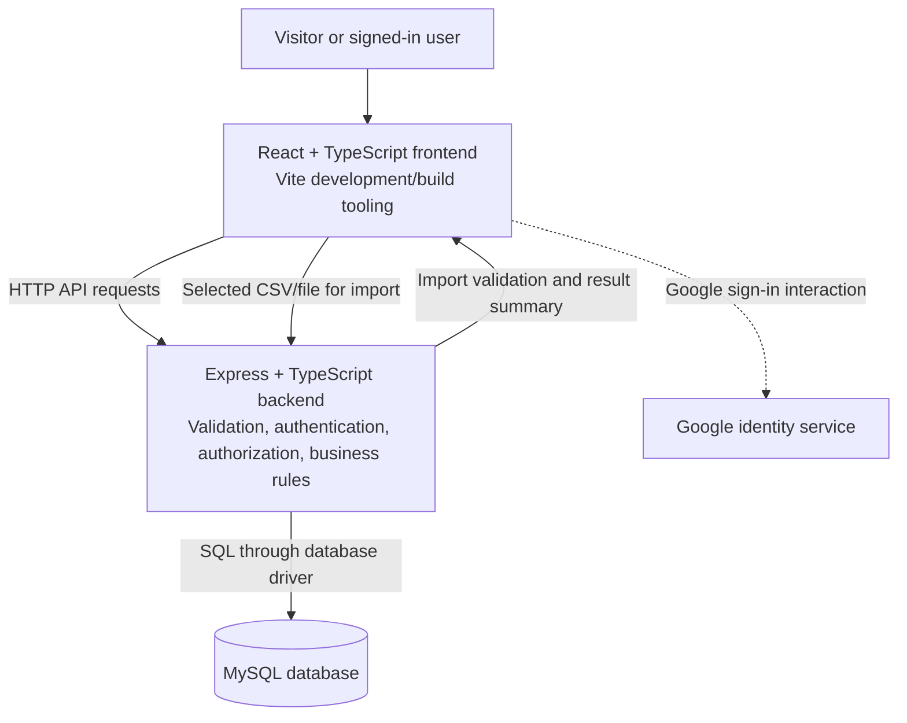

# Shark Tank India — Phase B, Step 6
## System Architecture

**Project type:** Independent academic DBMS prototype; not an official Shark Tank India service.

This document defines the high-level structure and responsibilities of the application components. It builds on the finalized requirements in Phase B Steps 1–5. It does not define the ER diagram, relational schema, detailed API routes, UI screens, or implementation code.

---

## 1. Architecture Overview

The application will use a three-layer web architecture:

1. **Presentation layer:** React, TypeScript and Vite.
2. **Application layer:** Node.js, Express and TypeScript.
3. **Data layer:** MySQL, accessed by the backend through a database driver.

The browser communicates with the backend over HTTP(S). The backend validates requests, applies authentication and authorization rules, enforces application-level business rules, and executes database operations. The browser must not connect directly to MySQL.

Google Sign-In identifies the Google account used for authentication; it does **not** verify that a person owns a business or is a legitimate investor. Historical information remains a set of data records, separate from platform accounts.

## 2. Component Responsibilities

### 2.1 Frontend — `client/`

**Technology:** React, TypeScript and Vite.

Responsibilities:
- Render public historical browsing, search, filtering, startup comparison and basic statistics.
- Provide sign-in and role-specific profile and listing workflows.
- Display connection-request status and provide accepted-connection messaging.
- Show validation errors, permission errors, loading states and operation results clearly.
- Submit requests to the backend and render responses; it must not contain database credentials or connect directly to MySQL.
- Keep private data out of public profile views and respect the role-based permissions returned/enforced by the backend.

The frontend may hide actions that a user cannot perform for usability, but hiding a control is not a security boundary. The backend must independently authorize every protected operation.

### 2.2 Backend — `server/`

**Technology:** Node.js, Express and TypeScript.

Responsibilities:
- Expose the application's HTTP API to the frontend.
- Verify authentication and associate each request with the relevant platform account and role(s).
- Enforce server-side role permissions, record ownership, public/private field rules and connection/messaging lifecycle rules.
- Validate request data before any database change.
- Coordinate historical-data creation and imports, including row validation and import summaries.
- Apply business rules for connection requests, message access, listing deletion, comparison limits and statistics.
- Access MySQL using server-side configuration and a database driver.
- Return consistent success and error responses without leaking credentials, SQL details or private message contents.

The backend is the only application component permitted to access the database directly.

### 2.3 Data layer — `database/`

**Technology:** MySQL.

Responsibilities:
- Persist historical show records, platform accounts and profiles, startup listings, connection requests, conversations/messages, and supporting administrative/import information as finalized in the database design phase.
- Enforce relational integrity through primary keys, foreign keys, uniqueness rules and appropriate constraints, as designed in Phase C and implemented in Phase D.
- Support searching, filtering, comparisons and aggregate statistics through queries executed by the backend.
- Persist accepted user changes so they remain available after the application restarts.

The detailed entities, attributes, keys, normalization decisions and physical schema are explicitly deferred to **Phase C: ER Model and Logical Design** and **Phase D: MySQL Implementation**.

### 2.4 External identity service — Google Sign-In

Responsibilities and boundaries:
- The user completes the Google sign-in interaction.
- The backend must validate the sign-in credential using a trusted Google-supported validation mechanism before treating the request as authenticated.
- The application maps a successfully authenticated Google identity to its own platform account and role/profile information.
- Role selection does not grant administrator access. Only an existing administrator can grant the Administrator role.
- Google authentication is not founder, company, or investor verification.

Credential verification details, session strategy and exact implementation libraries will be finalized during implementation. Client secrets, signing keys and other secrets must not be committed to Git.

### 2.5 Historical data import

CSV/file import is an administrative workflow, not a direct database upload from the browser.

1. An administrator selects a supported file in the frontend.
2. The backend checks the file type, size and structure and parses the input safely.
3. Each row is validated against the import rules and required relationships.
4. Valid rows are written through controlled database operations; invalid rows are not inserted.
5. The backend returns a result summary showing successful and failed rows and a reason for each failure.

A mixed result is permitted: valid rows can be imported while invalid rows are rejected. Import results must not expose database credentials or internal implementation details. The supported file format and limits will be set during implementation.

---

## 3. Main Request and Data Flows

### 3.1 Public historical browsing

1. A visitor opens a historical page, searches, filters or requests a comparison/statistic.
2. The frontend sends a request to the backend.
3. The backend validates query parameters and constructs an appropriate database operation.
4. MySQL returns the matching records or aggregate results.
5. The backend returns only fields appropriate for public viewing; the frontend displays the result.

### 3.2 Google Sign-In and role-specific access

1. A user completes Google Sign-In.
2. The backend validates the Google credential and identifies the platform account.
3. The platform account defaults to Viewer until the user chooses Founder or Investor, or both.
4. The backend checks the account's assigned role(s) and resource ownership on every protected action.
5. Administrator access can be granted only by an existing administrator.

### 3.3 Startup listing management

1. A signed-in founder submits a listing or an edit.
2. The backend confirms the Founder role, validates the submitted data and verifies listing ownership for edits.
3. The backend stores the change in MySQL.
4. The listing's public fields become available for public discovery; private account/contact information remains hidden.
5. Only the primary account owner can edit the listing in core scope. Other co-founders may be listed but do not receive editing rights.

### 3.4 Connection requests and messaging

1. An investor sends a request for a specific platform startup listing and its founder.
2. The backend checks role, listing status and connection/request rules, including prevention of duplicate pending or accepted connections for the same investor–founder pair.
3. The founder may accept or decline a pending request. The investor may withdraw a pending request.
4. Messaging becomes available only after acceptance and only to the two participants.
5. Either participant may end an accepted connection. After it ends, neither participant can send new messages, but both can read the existing conversation in read-only mode.
6. Administrators cannot read private message contents.
7. A later accepted request creates a new conversation; older conversations remain read-only.

If a startup listing is deleted, it is removed from public discovery, pending requests are marked `Withdrawn` with reason `listing deleted`, accepted connections are ended, and existing messages are retained for the participants in read-only mode.

### 3.5 Historical data entry and import

1. An administrator creates records manually or uploads a supported CSV/file.
2. The backend validates fields, formats, duplicate conditions and relevant relationships before insertion.
3. For a file import, valid rows may be inserted and invalid rows are rejected with row-level reasons.
4. The import result is returned to the administrator and recorded where required by the finalized data design.
5. Unknown deal outcomes or unavailable post-show attributes remain unknown/missing; the system must not infer that a televised deal closed.

---

## 4. Core Business and Security Boundaries

- **No direct database access from the browser:** database credentials and SQL operations remain on the backend.
- **Server-side authorization:** every protected read or write is checked using the authenticated account, assigned role(s), resource ownership and connection state.
- **Least privilege:** users receive only the access required by their roles. Viewers cannot change data; founders and investors cannot modify historical records; only administrators manage historical records.
- **Historical identity separation:** historical Shark records and registered platform investor accounts remain separate, even if they refer to the same person.
- **Private information:** email addresses, private contact information and private message contents are not publicly exposed. Administrators have no access to private message contents in core scope.
- **Connection state controls messaging:** active accepted connections allow both participants to read and send text messages; ended connections allow reading existing messages only.
- **Input validation:** the backend validates user-submitted content and import data before persistence. Client-side validation improves usability but does not replace backend validation.
- **Error handling:** responses must be understandable to the user without exposing credentials, stack traces, SQL statements or other sensitive internals.
- **Secrets and configuration:** environment-specific configuration and secrets stay outside committed source code. Example configuration may be documented without real secret values.
- **Unknown historical facts:** missing deal outcomes and unavailable post-show data remain explicitly unknown rather than being presented as confirmed facts.

---

## 5. Local Development and Runtime

The project is developed locally on the team's development machine and stored in the existing Git repository.

- `client/` contains the React application.
- `server/` contains the Express application.
- `database/` contains database scripts and related database artefacts as they are developed.
- `docs/` contains the requirements and design documentation.

For local development, the frontend development server and backend API run as separate processes, and the backend connects to a locally available MySQL instance using environment-based configuration. The current health-check endpoint is a starter verification endpoint, not a completed application API.

Online deployment is optional and remains outside the guaranteed core scope. The local prototype must be built and tested first.

---

## 6. Architectural Constraints and Quality Considerations

| Concern | Architectural approach |
|---|---|
| Security | Backend authentication and authorization; secrets kept server-side; database not exposed to the browser. |
| Data integrity | MySQL constraints plus backend validation; invalid import rows are not inserted. |
| Privacy | Public responses exclude private contact information and private message contents. |
| Maintainability | Separate frontend, backend, database scripts and documentation into the existing project directories. |
| Testability | Business rules are enforced in the backend and can be checked through API-level and end-to-end tests. |
| Performance | Filter and aggregate data in MySQL/backend rather than downloading the entire dataset to the browser. Add indexes only after the schema and query needs are known in Phases C–D. |
| Reliability | Clear error responses; persistent database storage; import summaries identify accepted and rejected rows. |
| Compatibility | Browser communicates with the backend through HTTP(S); frontend and backend use TypeScript. |

Specific performance targets, deployment architecture, rate limits, backup procedures and detailed monitoring are not fixed by this high-level architecture; avoid inventing numerical targets before they are agreed and tested.

---

## 7. Architecture Decisions Deferred to Later Phases

The following details are intentionally not decided in this document:

- Entity definitions, attributes, primary/foreign keys, cardinalities, normalization and relational mapping — **Phase C**.
- MySQL table creation, constraints, seed/sample data, indexes and import scripts — **Phase D**.
- Detailed API routes, request/response formats and consistent API error schema — subsequent implementation planning.
- Exact session/token strategy and Google Sign-In implementation library — backend implementation, subject to secure validation.
- Exact UI layouts and component design — frontend implementation planning.
- Specific import file size limits and supported CSV variants — implementation and testing.
- Optional features such as richer charts, bookmarks/watchlists and online deployment — included only as time permits, according to Step 1 priorities.

---

## 8. Consistency Checklist

Before this architecture is accepted, confirm that it is consistent with the approved requirements:

- [ ] React/TypeScript frontend communicates with the Express/TypeScript backend; the browser never connects directly to MySQL.
- [ ] Google Sign-In is authentication only, not business/investor verification.
- [ ] Viewer is the default role; users may select Founder and/or Investor; only an existing administrator grants Administrator access.
- [ ] Historical Sharks remain records, separate from platform investor accounts.
- [ ] Founders edit only their own startup listings; listings are publicly discoverable while private account/contact data remains hidden.
- [ ] Request, withdrawal, acceptance, decline, connection-ending and listing-deletion rules match Steps 2 and 3.
- [ ] Existing messages remain readable only to participants in read-only mode after a connection ends; administrators cannot read message contents.
- [ ] Valid CSV/file rows may be imported; invalid rows are rejected with reasons.
- [ ] Historical unknowns remain unknown; a televised offer is not automatically treated as a completed deal.
- [ ] Local prototype is the first delivery target; optional extensions remain optional.

---

## 9. Outcome of Step 6

This architecture establishes the responsibilities and communication boundaries among the frontend, backend, MySQL database, Google identity service and historical data import workflow. It is the high-level structural reference for later database design and implementation. It does not replace the ER model, relational schema, detailed API specification or implementation plan.
