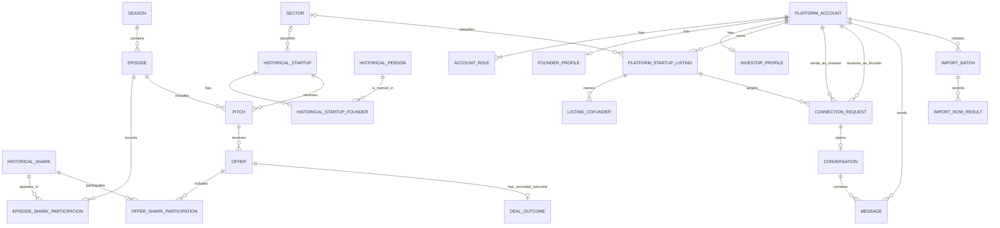
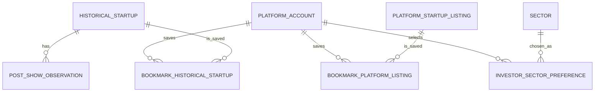

# Shark Tank India DBMS — Phase C, Step 3
## Conceptual Entity–Relationship Model and Diagram

**Purpose:** present the refined conceptual ER model based on Phase C Steps 1–2. The model identifies core entities, candidate identifiers, relationships, cardinalities, participation and special constraints. It is a conceptual model, not SQL DDL or a physical schema.

**Authority:** Phase B Steps 1–7 and Phase C Steps 1–2. If a name appears in the historical show data, that does not automatically identify it as a registered platform account.

---

## 1. Model boundary

The core ER model includes:

- Historical records: seasons, episodes, historical Sharks, episode participation, historical startups, historical people/founders, founder associations, pitches, offers, offer/Shark participation, deal outcomes and sectors.
- Platform records: accounts, role assignments, founder profiles, investor profiles, startup listings and informational co-founder entries.
- Connection and messaging records: connection requests/lifecycle, conversations and text messages.
- Import records: import batches and individual import-row results.

Optional extension entities—post-show observations, bookmarks/watchlists, investor preferences and structured source citations—are described separately and are not required in the core ER diagram.

## 2. Conceptual entity descriptions

| Entity | Identifier | Meaning |
|---|---|---|
| `SEASON` | `season_id` | One season of the programme. |
| `EPISODE` | `episode_id` | One episode in exactly one season. |
| `HISTORICAL_SHARK` | `shark_id` | A person recorded as a Shark appearing on the programme. |
| `EPISODE_SHARK_PARTICIPATION` | `(episode_id, shark_id)` | The association that a Shark appeared in an episode. |
| `SECTOR` | `sector_id` | A controlled sector/category value for consistent filtering. |
| `HISTORICAL_STARTUP` | `historical_startup_id` | A startup/business in the historical programme data. |
| `HISTORICAL_PERSON` | `historical_person_id` | A historical founder or presenter named in show data. |
| `HISTORICAL_STARTUP_FOUNDER` | `(historical_startup_id, historical_person_id)` | The historical association between a startup and a founder/presenter. |
| `PITCH` | `pitch_id` | A historical startup pitch in an episode. |
| `OFFER` | `offer_id` | An offer associated with a pitch. |
| `OFFER_SHARK_PARTICIPATION` | `(offer_id, shark_id)` | A Shark's participation in an offer, including joint offers. |
| `DEAL_OUTCOME` | `deal_outcome_id` | The latest/current recorded outcome for an offer, if known. |
| `PLATFORM_ACCOUNT` | `account_id` | An account authenticated through Google Sign-In. |
| `ACCOUNT_ROLE` | `(account_id, role_code)` | A role assigned to an account. |
| `FOUNDER_PROFILE` | `account_id` | The account's founder-specific profile. |
| `INVESTOR_PROFILE` | `account_id` | The account's investor-specific profile. |
| `PLATFORM_STARTUP_LISTING` | `listing_id` | A public listing managed by one primary founder account. |
| `LISTING_COFUNDER` | `cofounder_entry_id` | A named co-founder entry with no independent editing rights. |
| `CONNECTION_REQUEST` | `request_id` | Investor-to-founder request for a specific platform listing, including its lifecycle status. |
| `CONVERSATION` | `conversation_id` | A conversation created after one request is accepted. |
| `MESSAGE` | `message_id` | An immutable text message in a conversation. |
| `IMPORT_BATCH` | `import_batch_id` | One administrator-run file import for one record type. |
| `IMPORT_ROW_RESULT` | `(import_batch_id, row_number)` | The success/failure result for one input row. |

---

## 3. Core ER diagram (Mermaid)

The following diagram can be viewed in a Markdown renderer that supports Mermaid, including compatible GitHub Markdown views. The field lists show identifiers and the main references; complete attribute refinement appears in Step 2 and the relational mapping in Step 4.

### Reading the diagram

- `||` means exactly one; `o|` means zero or one; `o{` means zero or many; `|{` means one or many.
- Episode Shark Participation, Historical Startup Founder and Offer Shark Participation are associative entities that resolve many-to-many relationships.
- Founder Profile and Investor Profile are optional one-to-one extensions of an account, conditional on holding the corresponding role.
- The Conversation relationship is optional from Connection Request because pending, declined and withdrawn requests have no conversation. An accepted request creates exactly one conversation. It remains associated with that request after the connection ends.
- The diagram shows a Connection Request linked to its investor, founder and target listing. A separate constraint requires the recorded founder to be the listing's primary owner.

## 4. Optional extension model

These entities are excluded from the core ER diagram to keep the required model and implementation manageable. They may be added after core functionality is complete.

`DATA_SOURCE/CITATION` is still a candidate. If structured record-level source provenance is required, its relationships should be designed explicitly before implementation instead of using an unvalidated generic record-type/record-id link.

---

## 5. Cardinality and participation constraints

| Relationship | Cardinality and participation | Business constraint |
|---|---|---|
| Season–Episode | One Season has zero or many Episodes; each Episode has exactly one Season. | Episode number is unique within its Season. |
| Episode–Shark | Many-to-many via `EPISODE_SHARK_PARTICIPATION`. | One row per Episode/Shark pair. Attendance may be incomplete in sourced records. |
| Historical Startup–Historical Person | Many-to-many via `HISTORICAL_STARTUP_FOUNDER`. | One row per Startup/Person pair. A person is not automatically a platform user. |
| Episode–Pitch | One Episode has zero or many Pitches; each Pitch belongs to one Episode. | Pitch must refer to a recorded Episode. |
| Historical Startup–Pitch | One Startup may have zero or many Pitches; each Pitch concerns one Startup. | Do not assume a fixed one-pitch-per-company rule. |
| Pitch–Offer | One Pitch has zero or many Offers; each Offer belongs to one Pitch. | A Pitch may exist without any offer. |
| Offer–Shark | Many-to-many via `OFFER_SHARK_PARTICIPATION`. | One row per Offer/Shark pair; supports joint offers. |
| Offer–Deal Outcome | One Offer has zero or one current recorded outcome. | Unknown/unavailable is not a confirmed closure. |
| Account–Role | One Account has one or more assigned roles. | Viewer is the default; Founder and Investor may both be assigned; Administrator is granted only by an existing administrator. |
| Account–Founder/Investor Profile | Zero or one of each profile per account. | Profile requires its corresponding role assignment. |
| Account–Listing | One account may own zero or many listings; each listing has one primary owner. | Owner must hold Founder role. Named co-founders get no edit rights. |
| Investor–Connection Request | One investor may send many requests over time; each request has one investor. | At most one Pending or Accepted connection per investor/founder pair at a time, regardless of target listing. |
| Founder–Connection Request | One founder may receive many requests over time; each request identifies one founder. | Founder must be the primary owner of the target listing. |
| Listing–Connection Request | One listing may have many requests over time; each request identifies one listing. | Listing deletion closes associated requests/connections according to finalized lifecycle rules. |
| Request–Conversation | A request has zero or one conversation; each conversation belongs to exactly one accepted request. | Re-requesting after a terminal state and later acceptance creates a new conversation. |
| Conversation–Message | A conversation has zero or many messages; each Message belongs to one Conversation. | Only the two participants may read messages. After connection end, prior messages are read-only. |
| Account–Message | One account may send zero or many messages. | Sender must be one of the two connection participants. Administrators cannot read message contents. |
| Import Batch–Row Result | A batch has zero or many row results; each result belongs to one batch. | One result per processed input row; failures require a reason. |

## 6. Additional constraints not fully expressed by ER notation

1. **Conditional uniqueness of active connections:** a pair may have no more than one `Pending` or `Accepted` connection simultaneously. After `Declined`, `Withdrawn` or `Ended`, a new request may be created.
2. **Self-connection prevention:** an account holding both Founder and Investor roles cannot request a connection to a listing it owns.
3. **Listing deletion:** use a logical deletion/status change. Remove the listing from discovery, mark its pending requests `Withdrawn` with reason `listing deleted` and actor `system`, set its accepted connections to `Ended` with that reason, and retain message history read-only for participants.
4. **Conversation lifecycle:** sending is permitted only while connection status is `Accepted` and not ended. Reading existing messages is permitted to both participants after end, but sending is not.
5. **Role-dependent profile existence:** a Founder Profile requires Founder role; an Investor Profile requires Investor role. An account may have both.
6. **Source separation:** a Historical Startup cannot be silently treated as a Platform Startup Listing. Direct linking is outside core scope; if the optional linking feature is added later, it requires administrator approval.
7. **Data uncertainty:** unknown fields remain unknown/not available. Missing source data must not be replaced with invented values or zero by default.
8. **Partial imports:** valid input rows may be inserted while invalid rows are rejected, each with a clear recorded result. Counts are derived from row results.
9. **Private data:** public queries never expose emails, private contact details or private messages to non-participants.

## 7. Design rationale

- **Associative entities** make many-to-many relationships explicit and preserve any relationship-specific attributes.
- **Stable identifiers** avoid ambiguity when names repeat or change.
- **Separate historical/platform entities** protect historical integrity and prevent unauthorized account-to-show identity inference.
- **A controlled Sector entity** standardizes values used in filters and reduces inconsistent spelling.
- **Request and Conversation separation** retains request history and allows later requests to start independent conversations without reopening old messages.
- **Soft deletion** preserves referential history and satisfies the message-retention rules while removing a listing from public discovery.
- **Import Row Result** stores both successful and rejected row outcomes so an administrator can reopen a report.
- **Extension separation** stops optional features from making the core schema unnecessarily large.

## 8. Review checklist

Before approving the conceptual model, confirm that:

- [ ] Every core entity has a stable candidate identifier.
- [ ] Every many-to-many relationship has an associative entity.
- [ ] Mandatory and optional participation are documented.
- [ ] All connection, listing deletion and messaging rules are noted alongside the ER diagram.
- [ ] Historical Shark records, historical startups and platform accounts/listings remain distinct.
- [ ] Unknown outcomes and optional facts can be represented without inventing data.
- [ ] Optional extension entities are visibly separated from core entities.

**Deliverable status:** conceptual ER model and Mermaid diagram proposal. The next step is logical mapping from the approved ER model to relations, primary keys and foreign keys. No SQL DDL is created here.
